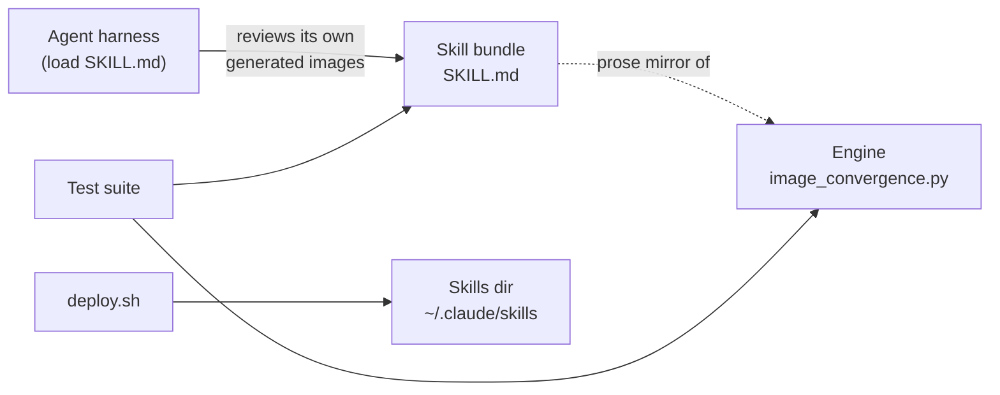

# Technical Architecture

Three components in one repo, one artifact of value:

1. **Skill bundle** (`skill/image-convergence/SKILL.md`) — prose protocol an agent consumes directly. No runtime of its own.
2. **Loop engine** (`engine/image_convergence.py`) — pure Python, stdlib-only, zero dependencies. Holds the decision rule (thresholds, stall, rotation, stop conditions) so tests can pin behavior.
3. **Staging scripts** (`scripts/staging/`) — copy the bundle into a filesystem skills dir with branch-scoped slots.

Tech stack: Python 3.12+ stdlib for the engine and tests; POSIX bash for staging scripts; SKILL.md frontmatter protocol for the bundle. Detail in [`technical-architecture/tech-stack.md`](technical-architecture/tech-stack.md) and [`technical-architecture/c4/`](technical-architecture/c4/).
