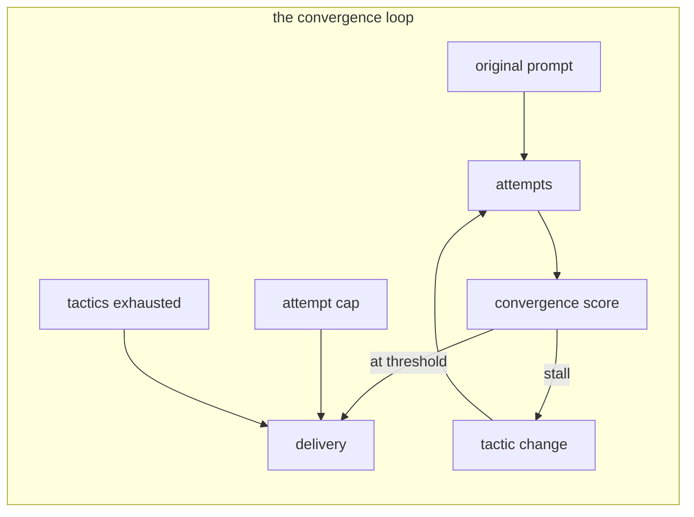

# Domain Model (L1)

One bounded context: **the convergence loop** — the practice of reviewing a generated image against its original prompt and iterating until the image satisfies the prompt.

Core vocabulary (prose narratives):

- **Original prompt** — the stated image request; the fixed ground truth of the whole loop. Every review measures distance against it, never against an earlier attempt.
- **Attempt** — one generate-and-review cycle. Attempts are numbered and cumulative: each prompt carries forward every element the image already satisfied.
- **Compliance dimension** — one of five aspects (subject, composition, style, detail, palette-and-lighting) that reviews judge independently.
- **Convergence score** — the attempt's overall merit, defined as its weakest dimension. Weakest-link semantics keep a single glaring miss from hiding behind strong averages.
- **Stall** — a run of attempts with a flat-or-lower best score; the trigger for creative movement.
- **Tactic** — a named revision strategy from a fixed menu, applied on stall and held for a window of attempts.
- **Delivery** — the single user-facing output: the best image, the ledger, the stop reason, and the final prompt.
- **Positive guiding** — the loop's language discipline: instructions and revisions state what is present and what arrives next.

Relations: an *attempt* produces a *convergence score* per *compliance dimension*; *stalls* rotate *tactics*; the loop ends in a *delivery* through one of three stop conditions (converged, attempt cap, tactics exhausted).

See [`domain-architecture/DOMAIN-MODEL-L2.md`](domain-architecture/DOMAIN-MODEL-L2.md) for the precise (L2) definitions the tests pin.
